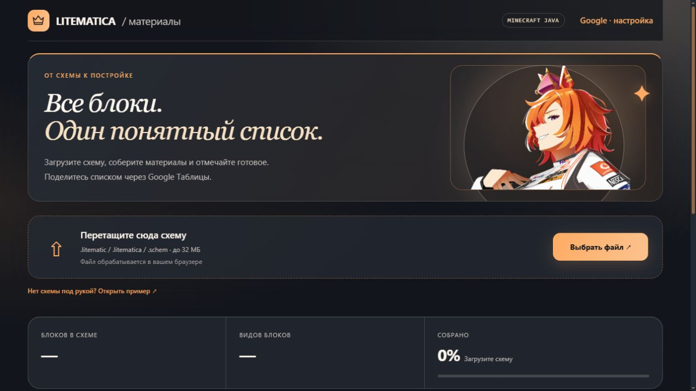
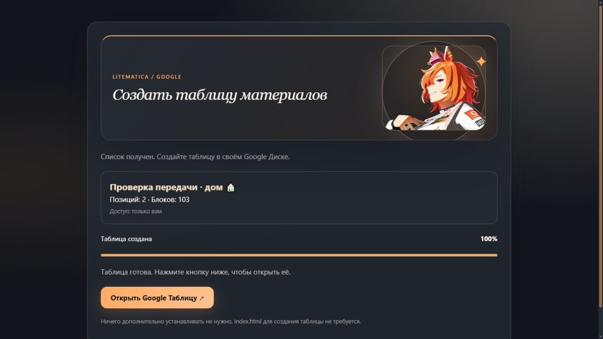
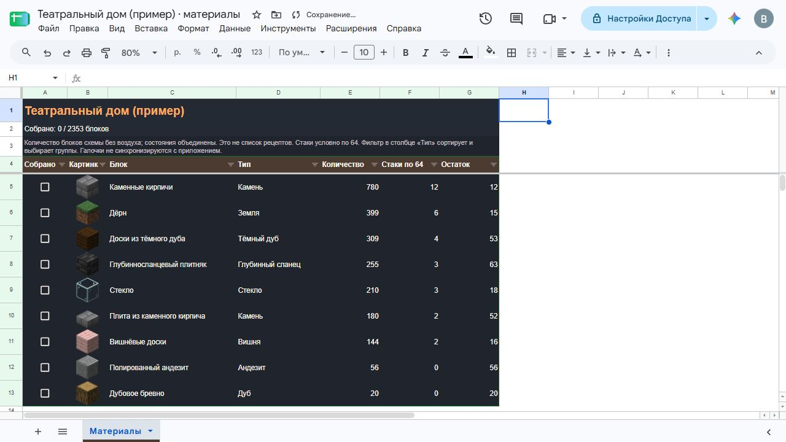

# Litematica Materials

Список материалов из схем Minecraft: картинки блоков, количество, группы и галочки собранного. Поддерживаются `.litematic`, `.litematica` и Sponge `.schem` v1–v3. Есть вращаемый 3D-предпросмотр и экспорт в Google Таблицы.

## Запуск

1. [Скачайте готовый kit](https://github.com/Abobamonster/litematica-materials/releases/latest/download/litematica-kit.zip) и распакуйте его.
2. Откройте **Index.html** в актуальном Chrome или Edge.
3. Загрузите схему. При необходимости выберите группу, отмечайте собранное или сохраните CSV.

Если браузер ограничивает открытие локального файла, в папке репозитория запустите `python -m http.server 8000` и откройте http://localhost:8000/Index.html.

## Подключение Google Таблиц

1. Создайте проект на [Google Apps Script](https://script.google.com/) и вставьте содержимое **Code.gs** в файл кода.
2. **Развернуть → Новое развертывание → Веб-приложение**: выполнять **от вашего имени**, доступ **«Только я»**. Подтвердите разрешения.
3. Скопируйте ссылку **…/exec** в **«Google · настройка»** приложения.
4. Загрузите схему → **«Создать Google Таблицу»** → подтвердите в новой вкладке. Доступ к таблице выбирается при создании.

Для Google-экспорта достаточно одного **Code.gs**. Для обновления замените его и выберите **Управление развертываниями → карандаш → Новая версия → Развернуть**.

Схема разбирается в браузере. В Google передаётся только список материалов. Большие схемы упрощаются только в предпросмотре; количество блоков считается по исходному файлу. Это количество установленных блоков, а не расчёт рецептов. Текстуры — ванильные 1.21.4; особые блоки и соединения могут отображаться приблизительно.

[Разработка и проверки](DEVELOPMENT.md) · [Источники ресурсов](ИСТОЧНИКИ.txt)

## Скриншоты

**Главный экран**

**Окно экспорта с полосой прогресса** (демонстрационный запуск)

**Пример оформления Google Таблицы**

[Мобильный вид](docs/screenshots/site-mobile.jpg) · [Вращаемый 3D-пример](docs/screenshots/site-3d.jpg)
